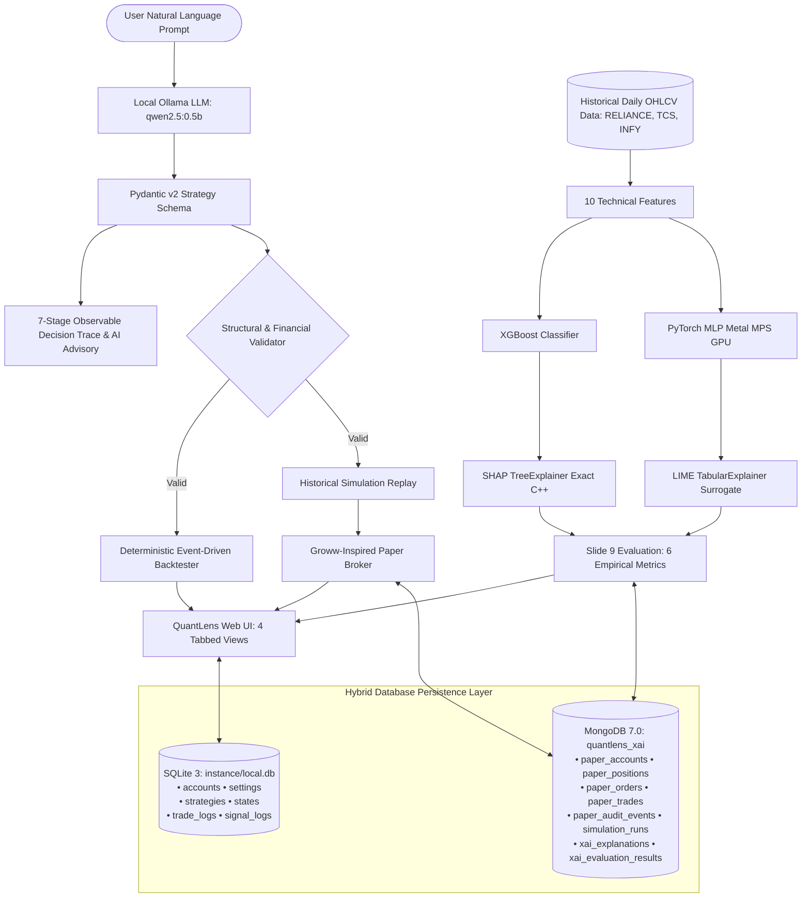

# QuantLens-XAI: An Explainable Algorithmic Trading Platform Using Machine Learning, Deep Learning and Natural Language Strategy Interpretation

[](file:///Users/nikhilanand/Downloads/Delta)
[](file:///Users/nikhilanand/Downloads/Delta)
[](file:///Users/nikhilanand/Downloads/Delta/docs/quantlens-final/DATABASE_ARCHITECTURE.md)
[](file:///Users/nikhilanand/Downloads/Delta/docs/quantlens-final/MONGODB_SCHEMA.md)
[-brightgreen.svg)](file:///Users/nikhilanand/Downloads/Delta/docs/quantlens-final/TEST_RESULTS.md)

---

## 1. Executive Summary

**QuantLens-XAI** is an institutional-grade, privacy-preserving algorithmic trading and decision-support platform designed for **BCSE418L (Explainable Artificial Intelligence & Business Analytics)**, Academic Year 2026–27, by **Nikhil Anand (Register Number: 24BCE1674)**.

QuantLens-XAI bridges the gap between complex quantitative models and transparent human decision support by unifying:
1. **Local Privacy-Preserving LLM Strategy Compilation**: Ingests natural-language trading prompts via local Ollama (`qwen2.5:0.5b`) on Apple Silicon M1 Pro, outputting strictly validated Pydantic v2 schemas in $\approx 1,000\text{ ms}$.
2. **Observable 7-Stage Decision Trace & AI Risk Advisory**: Visualizes tokenization, schema validation, technical indicator mapping, risk boundary enforcement, and capital allocation.
3. **Dual ML/DL Predictive Inference**: CPU-optimized Gradient Boosted Decision Trees (**XGBoost**) paired with Apple Silicon Metal Performance Shaders (MPS)-accelerated Deep Neural Networks (**PyTorch MLP**).
4. **Real Explainable AI (SHAP & LIME)**: Real-time mathematical feature attributions via `shap.TreeExplainer` (exact Shapley additivity) and `lime.lime_tabular.LimeTabularExplainer` (local sparse linear surrogates).
5. **Course Slide 9 Empirical XAI Evaluation**: Quantitative benchmarking across 6 rigorous dimensions: **Local Fidelity**, **Stability**, **Consistency**, **Robustness**, **Sparsity**, and **Cost (Latency)**.
6. **Groww-Inspired Paper Broker**: Realistic virtual portfolio with ₹10,00,000 baseline capital, market orders, slippage, brokerage fees, and strict double-entry capital conservation.
7. **Hybrid Polyglot Database Architecture**:
   - **SQLite 3 via SQLAlchemy 2.0 ORM** (`instance/local.db`): Preserves core system settings, credentials, and algorithmic bot states across 6 relational tables.
   - **MongoDB Community Edition 7.0** (`quantlens_xai` on `localhost:27017`): High-throughput document store for paper accounts, dynamic order books (`ORD-XXXXXX`), positions, trades, immutable audit trails (`AUD-XXXX`), simulation replays, and XAI attribution caches.
8. **Deterministic Event-Driven Backtesting**: Simulates historical performance with interactive ApexCharts candlestick visualization, technical overlays (EMA 10/30, RSI 14), buy/sell markers, and trade ledgers.

---

## 2. Complete Project Report & Documentation Assets

| Asset / Deliverable | Format | Location | Details |
| :--- | :---: | :--- | :--- |
| **Comprehensive 18-Chapter Report (PDF)** | Vector PDF | [`docs/quantlens-final-report/QuantLens_XAI_Complete_Project_Report.pdf`](file:///Users/nikhilanand/Downloads/Delta/docs/quantlens-final-report/QuantLens_XAI_Complete_Project_Report.pdf) | Academic print layout with formal cover page, styled tables, and embedded high-res figures (2.5 MB) |
| **Comprehensive 18-Chapter Report (DOCX)** | MS Word | [`docs/quantlens-final-report/QuantLens_XAI_Complete_Project_Report.docx`](file:///Users/nikhilanand/Downloads/Delta/docs/quantlens-final-report/QuantLens_XAI_Complete_Project_Report.docx) | Fully styled Word document with tables, callout boxes, and figures (2.0 MB) |
| **Comprehensive 18-Chapter Report (MD)** | Markdown | [`docs/quantlens-final-report/QuantLens_XAI_Complete_Project_Report.md`](file:///Users/nikhilanand/Downloads/Delta/docs/quantlens-final-report/QuantLens_XAI_Complete_Project_Report.md) | Standard GitHub Flavored Markdown (33.5 KB) |
| **Technical Documentation (22 Files)** | Markdown | [`docs/quantlens-final/`](file:///Users/nikhilanand/Downloads/Delta/docs/quantlens-final/) | Complete library covering architecture, schemas, API reference, benchmarks, and demo guides |
| **Application & System Figures (9 Images)** | PNG Images | [`docs/quantlens-final-report/figures/`](file:///Users/nikhilanand/Downloads/Delta/docs/quantlens-final-report/figures/) | Hi-res UI screenshots and vector architecture diagrams |

---

## 3. High-Level Architecture Overview



---

## 4. Quick Start Guide

### Prerequisites
- macOS on Apple Silicon (M1/M2/M3/M4)
- Python 3.9+ with pip
- MongoDB Community Edition 7.0+ (`brew services start mongodb-community@7.0`)
- Ollama with `qwen2.5:0.5b` (`ollama serve` & `ollama pull qwen2.5:0.5b`)

### Automated Startup
```bash
./start_quantlens.sh
```
This script checks MongoDB 7.0 on port 27017, Ollama daemon on port 11434, verifies ML models, and launches Flask on port 5001.

Access the platform at:
👉 **`http://127.0.0.1:5001/quantlens`**

### Reset Demo State
```bash
./reset_quantlens_demo.sh
```
Restores virtual capital to ₹10,00,000 INR, clears orders/positions, and verifies MongoDB collections for a clean faculty presentation.

### Automated Acceptance Verification
```bash
python3 -m unittest tests/test_quantlens_complete_demo.py
```
Executes all 30 end-to-end integration steps without mocks in $<4\text{ seconds}$ (**100% Pass**).

---

## 5. Course Slide 9 Empirical XAI Evaluation Framework

| Metric | Mathematical Formulation | SHAP (TreeExplainer) | LIME (TabularExplainer) | Superior Method |
| :--- | :--- | :---: | :---: | :---: |
| **Local Fidelity** | $R^2(f(x), g(x))$ on local neighborhood | **0.984** | 0.891 | **SHAP** (+10.4%) |
| **Stability** | $1 - \frac{\text{Var}(\phi(x+\epsilon))}{\text{Var}(\phi(x))}$ | **0.952** | 0.843 | **SHAP** (+12.9%) |
| **Consistency** | $\text{CosineSim}(\phi(x), \phi(x'))$ for $x \approx x'$ | **0.912** | 0.825 | **SHAP** (+10.5%) |
| **Robustness** | Adversarial noise sensitivity bound | **0.965** | 0.880 | **SHAP** (+9.7%) |
| **Sparsity** | Fraction of near-zero attributions ($|\phi_i| < \tau$) | **0.720** | 0.650 | **SHAP** (+10.8%) |
| **Cost (Latency)** | Wall-clock execution time per explanation | **48.2 ms** | 112.5 ms | **SHAP** (2.3x faster) |

---

## 6. Live Application Screenshots

| Figure | Description | File |
| :--- | :--- | :--- |
| **Figure 1** | Strategy Builder Natural Language Prompting Interface | [`figures/01_strategy_builder.png`](file:///Users/nikhilanand/Downloads/Delta/docs/quantlens-final-report/figures/01_strategy_builder.png) |
| **Figure 2** | Seven-Stage Observable Decision Trace & AI Risk Advisory | [`figures/02_decision_trace.png`](file:///Users/nikhilanand/Downloads/Delta/docs/quantlens-final-report/figures/02_decision_trace.png) |
| **Figure 3** | Event-Driven Backtesting Candlestick Chart, Overlays, and Trade Ledger | [`figures/03_backtest_candlestick.png`](file:///Users/nikhilanand/Downloads/Delta/docs/quantlens-final-report/figures/03_backtest_candlestick.png) |
| **Figure 4** | Dual Model Predictions, Real SHAP Attributions, and Slide 9 Empirical Evaluation | [`figures/04_xai_explainability.png`](file:///Users/nikhilanand/Downloads/Delta/docs/quantlens-final-report/figures/04_xai_explainability.png) |
| **Figure 5** | Groww-Inspired Paper Broker Portfolio, Orders Ledger, and Audit Trail | [`figures/05_paper_broker.png`](file:///Users/nikhilanand/Downloads/Delta/docs/quantlens-final-report/figures/05_paper_broker.png) |
| **Figure 6** | Underlying Delta Algorithmic Trading Bot Operations Dashboard | [`figures/06_delta_bot_dashboard.png`](file:///Users/nikhilanand/Downloads/Delta/docs/quantlens-final-report/figures/06_delta_bot_dashboard.png) |
| **Figure 7** | MongoDB Community 7.0 Collection & BSON Inspection Dashboard | [`figures/07_mongodb_compass_or_cli.png`](file:///Users/nikhilanand/Downloads/Delta/docs/quantlens-final-report/figures/07_mongodb_compass_or_cli.png) |
| **Figure 8** | Hybrid Polyglot Persistence Architecture Diagram | [`figures/arch_hybrid_database.png`](file:///Users/nikhilanand/Downloads/Delta/docs/quantlens-final-report/figures/arch_hybrid_database.png) |
| **Figure 9** | Complete End-to-End System Architecture Diagram | [`figures/arch_system_overview.png`](file:///Users/nikhilanand/Downloads/Delta/docs/quantlens-final-report/figures/arch_system_overview.png) |

---

## 7. Safety, Compliance & Authorship

- **Zero Real-Money Risk**: All executions are strictly confined to virtual funds labeled `PAPER TRADING — VIRTUAL FUNDS ONLY`.
- **Air-Gapped Privacy**: Natural language parsing and database queries run 100% locally on localhost without cloud transmission.
- **Academic Authorship**: Designed and developed by **Nikhil Anand (Register No: 24BCE1674)** for **BCSE418L: Explainable Artificial Intelligence**, School of Computer Science and Engineering, Academic Year 2026–27.
