# DA3 Video Demonstration: Visual Storyboard & Transitions
## Course: Cloud Architecture Design (BCSE355L) — Academic Year 2026–27
**Target Duration**: 00:00 to 05:00 (300 Seconds)  
**Layout Scheme**: 10 Sequenced Visual Scenes  

---

## Scene Flow Architecture

```mermaid
flowchart LR
    S1["Scene 1 (00:00-00:25)<br/>Title & Intro"] --> S2["Scene 2 (00:25-01:05)<br/>Live UI & Vaults"]
    S2 --> S3["Scene 3 (01:05-01:50)<br/>Simulation & Charts"]
    S3 --> S4["Scene 4 (01:50-02:15)<br/>Cloud Architecture"]
    S4 --> S5["Scene 5 (02:15-02:50)<br/>Amazon EC2 Compute"]
    S5 --> S6["Scene 6 (02:50-03:20)<br/>AWS SSM & Docker"]
    S6 --> S7["Scene 7 (03:20-03:50)<br/>EBS Storage & SG"]
    S7 --> S8["Scene 8 (03:50-04:20)<br/>CloudWatch Logs/Alarm"]
    S8 --> S9["Scene 9 (04:20-04:40)<br/>IAM & Cost Control"]
    S9 --> S10["Scene 10 (04:40-05:00)<br/>Results & Viva Wrap-up"]
```



---

## Scene 1: Introduction & Title [00:00 – 00:25]
```
+--------------------------------------------------------------------------+
|  https://13-203-204-25.sslip.io/dashboard                     [LOCK ICON]|
+--------------------------------------------------------------------------+
|  Delta Bot Admin Dashboard         [Accounts] [PnL] [Analytics] [Settings]
|                                                                          |
|   +------------------------------------------------------------------+   |
|   |  AUTOMATED ALGORITHMIC TRADING SYSTEM - BCSE355L DA3             |   |
|   |  Cloud Architecture Design - 2026-27 | ap-south-1 Mumbai         |   |
|   +------------------------------------------------------------------+   |
+--------------------------------------------------------------------------+
```
- **Visual**: Browser Tab 1. Crisp clean dashboard landing page with browser-trusted HTTPS padlock.
- **Audio**: Formal presentation opening; project title, student name, course code, and target AWS region.
- **Transition**: Smooth mouse scroll down to account cards at 00:25.

---

## Scene 2: Live Trading Dashboard & Multi-Account Vaults [00:25 – 01:05]
```
+--------------------------------------------------------------------------+
|  [Accounts Tab Active]                                                   |
|  +---------------------------+       +---------------------------+       |
|  | Alpha Momentum Fund       |       | Delta Grid & Arbitrage    |       |
|  | Leverage: 50x             |       | Leverage: 20x             |       |
|  | Buffer: 80% (Percentage)  |       | Buffer: 60% (Percentage)  |       |
|  | [Check Balance] -> $25.40 |       | [Check Balance]           |       |
|  +---------------------------+       +---------------------------+       |
+--------------------------------------------------------------------------+
```
- **Visual**: 4 paper-trading vault cards. Cursor moves to Account #1 and clicks `Check Balance`. Toast popup appears confirming `$25.40 USD`.
- **Audio**: Explanation of multi-tenant portfolio segregation and safe sandboxed balances.
- **Transition**: Click on `Alert Playground` in the top navigation bar at 01:05.

---

## Scene 3: Algorithmic Simulation & Performance Analytics [01:05 – 01:50]
```
+--------------------------------------------------------------------------+
|  [Alert Playground Active]                                               |
|  Ticker: [ ETHUSD.P v ]   Action: [ BUY v ]   [ RUN SIMULATION BUTTON ]  |
|                                                                          |
|  +--- SIMULATION LOGS CONSOLE -----------------------------------------+ |
|  | [SUCCESS] Simulation complete. Ticker: ETHUSD.P (Lot Size: 0.01)    | |
|  |  Account: Alpha Momentum Fund -> BUY 86266 lots @ mark $2318.39    | |
|  |  Account: Delta Grid -> BUY 25878 lots... Margin: $29999.70 USD    | |
|  +---------------------------------------------------------------------+ |
+--------------------------------------------------------------------------+
```
- **Visual**: Ticker `ETHUSD.P` and action `BUY` selected. Click `Run Simulation`. Instant console output. Switch to `Performance Analytics` tab to display equity curve and Sharpe Ratio (3.30).
- **Audio**: Explanation of mathematical position sizing, real mark prices, and quantitative performance metrics.
- **Transition**: Click on `Global Settings` tab at 01:50.

---

## Scene 4: AWS Cloud Architecture Overview [01:50 – 02:15]
```
+--------------------------------------------------------------------------+
|  [Global Settings Active]                                                |
|  Webhook URL: https://13-203-204-25.sslip.io/webhook                     |
|  Local Bot Dry Run: [ TRUE ] (Paper Trading Safe Mode Enforced)          |
|                                                                          |
|  Architecture: HTTPS (443) -> Nginx Reverse Proxy -> Gunicorn (5000)     |
|                -> Encrypted EBS (SQLite) -> CloudWatch Agent             |
+--------------------------------------------------------------------------+
```
- **Visual**: Highlighting the production webhook URL and dry-run flag.
- **Audio**: Architectural narration connecting client requests, Docker containerization, and backend WSGI worker.
- **Transition**: Switch to Browser Tab 2 (Amazon EC2 Console) at 02:15.

---

## Scene 5: Amazon EC2 Compute Infrastructure [02:15 – 02:50]
```
+--------------------------------------------------------------------------+
|  AWS Management Console > EC2 > Instances > ap-south-1 (Mumbai)          |
+--------------------------------------------------------------------------+
|  [X] i-0affed362f3927281 | Running | t3.micro | 2/2 passed | 13.203.204.25
|                                                                          |
|  +-- Details Panel ----------------------------------------------------+ |
|  | Instance ID: i-0affed362f3927281     Public IPv4: 13.203.204.25     | |
|  | Instance Type: t3.micro (Free Tier)  VPC: vpc-0b8ce57f3f19e8055     | |
|  +---------------------------------------------------------------------+ |
+--------------------------------------------------------------------------+
```
- **Visual**: EC2 instances table with row selected. Highlight `t3.micro`, `Running`, `2/2 passed`, and `13.203.204.25`.
- **Audio**: Justifying compute choice under Free Tier (750 hours/month), zero ALB/NAT waste, and elastic IP allocation.
- **Transition**: Switch to Browser Tab 3 (AWS Systems Manager) at 02:50.

---

## Scene 6: Docker Container Stack via AWS SSM [02:50 – 03:20]
```
+--------------------------------------------------------------------------+
|  AWS Systems Manager > Session Manager (Terminal Shell)                  |
+--------------------------------------------------------------------------+
|  sh-5.2$ cd /opt/delta-bot                                               |
|  sh-5.2$ docker compose ps                                               |
|  NAME              COMMAND                  STATUS          PORTS        |
|  delta-bot-nginx   "/docker-entrypoint…"    Up 40 min       80->80, 443  |
|  delta-bot-app     "gunicorn --bind 0.0…"   Up 40 min       5000/tcp     |
+--------------------------------------------------------------------------+
```
- **Visual**: Active browser-based SSM terminal. Run `docker compose ps` to show both containers running.
- **Audio**: Explaining how Session Manager eliminates the need for open SSH port 22, guaranteeing microservice container isolation.
- **Transition**: Switch to Browser Tab 4 (Amazon EBS) at 03:20.

---

## Scene 7: Amazon EBS Storage & Network Security [03:20 – 03:50]
```
+--------------------------------------------------------------------------+
|  AWS EC2 > Volumes (Tab 4) -> Security Groups (Tab 5)                    |
+--------------------------------------------------------------------------+
|  Volume: vol-00d3397bf9149f76b | 30 GiB | gp3 | Attached: /dev/xvda      |
|  Encryption: Encrypted (AWS KMS Managed Key)                             |
|                                                                          |
|  Security Group: sg-05a5e6777dcfe4936                                    |
|  Inbound Rules: TCP 80 (HTTP) | TCP 443 (HTTPS) | NO PORT 22 (SSH)       |
+--------------------------------------------------------------------------+
```
- **Visual**: Show EBS 30 GiB encrypted volume. Switch to Tab 5 to display Security Group inbound rules (80 and 443 only; zero port 22).
- **Audio**: Free Tier 30 GiB storage allowance, SQLite database persistence, and perimeter network hardening against brute-force attacks.
- **Transition**: Switch to Browser Tab 6 (CloudWatch Logs) at 03:50.

---

## Scene 8: Amazon CloudWatch Monitoring & Real Logs [03:50 – 04:20]
```
+--------------------------------------------------------------------------+
|  CloudWatch > Log Groups > /aws/ec2/delta-bot > Stream: ...-app          |
+--------------------------------------------------------------------------+
|  2026-10-24 17:18:06 - INFO - Fetching products list from Delta Exchange |
|  127.0.0.1 - - [24/Oct/2026:17:18:06 +0000] "GET /health HTTP/1.1" 200  |
|                                                                          |
|  CloudWatch Alarms (Tab 7):                                              |
|  [ OK ] DeltaBot-HighCPUUtilization (CPUUtilization > 80% for 2 periods) |
+--------------------------------------------------------------------------+
```
- **Visual**: Real application logs streaming in real-time. Switch to Tab 7 to display the green `OK` status on `DeltaBot-HighCPUUtilization`.
- **Audio**: Explaining the Unified Agent architecture, central log aggregation, and automated alarm thresholds for proactive ops.
- **Transition**: Switch to Browser Tab 8 (AWS IAM Roles) at 04:20.

---

## Scene 9: AWS IAM Least-Privilege & Cost Management [04:20 – 04:40]
```
+--------------------------------------------------------------------------+
|  IAM > Roles > DeltaTradingBot-InstanceRole-ap-south-1                   |
+--------------------------------------------------------------------------+
|  Role ARN: arn:aws:iam::704475327110:role/DeltaTradingBot-InstanceRole…  |
|  Attached Policies:                                                      |
|   - AmazonSSMManagedInstanceCore                                         |
|   - CloudWatchAgentServerPolicy                                          |
|  Zero Static Keys Stored | Free Tier Eligible (~₹4.20 Evaluation Cost)   |
+--------------------------------------------------------------------------+
```
- **Visual**: IAM Role permissions table displaying the two attached managed policies.
- **Audio**: Least-privilege instance profile, automatic STS credential rotation, and empirical cost breakdown (~₹4.20 INR total).
- **Transition**: Switch back to Browser Tab 1 (Trading Dashboard) at 04:40.

---

## Scene 10: Conclusion & Academic Viva Wrap-Up [04:40 – 05:00]
```
+--------------------------------------------------------------------------+
|  https://13-203-204-25.sslip.io/dashboard                                |
+--------------------------------------------------------------------------+
|  Delta Bot Admin Dashboard                                               |
|  - 38/38 Test Suites Passed (100% Pass Rate)                             |
|  - 12-Section Academic Report Submitted (<10% Turnitin Similarity)       |
|  - Working Live Production Application on AWS Mumbai                     |
|                                                                          |
|                   "Thank you for your time and attention."               |
+--------------------------------------------------------------------------+
```
- **Visual**: Full browser view of live trading application with clean navigation bar and live paper accounts.
- **Audio**: Academic conclusion, summary of deliverables, and opening for viva questions.
- **Final Action**: Stop recording exactly at 05:00.
