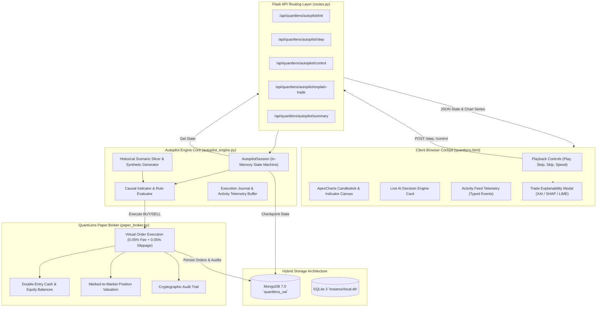
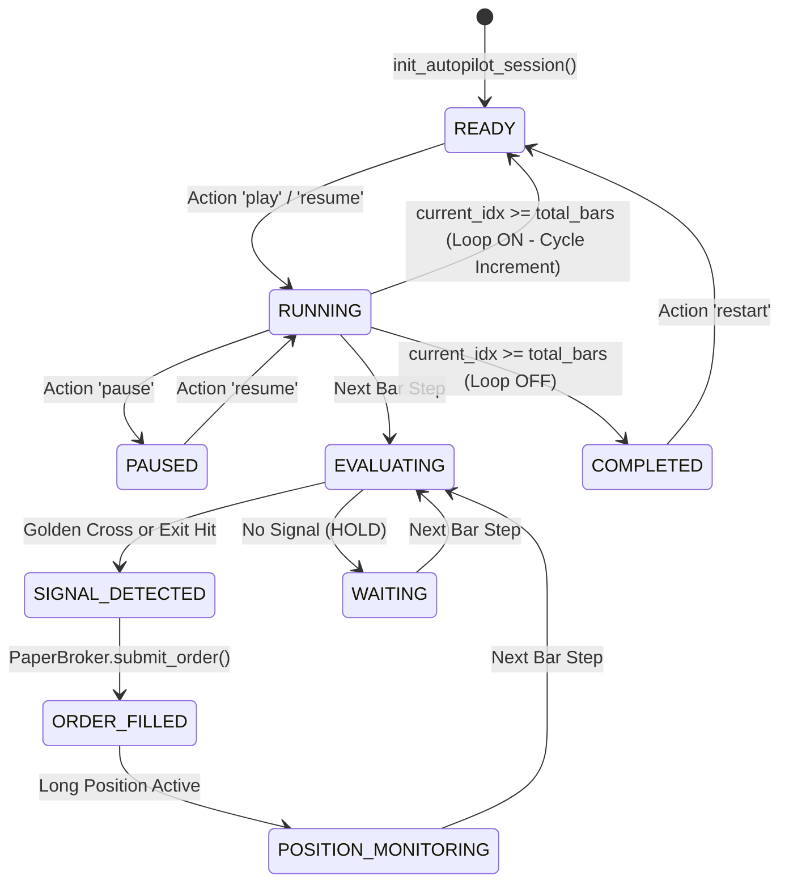

# QuantLens Autopilot — Architectural Specification

**Authoritative Backend State Machine & Financial Simulation Pipeline**

---

## 1. System Architecture Overview

QuantLens Autopilot follows a strict separation of concerns between authoritative server-side simulation logic and responsive client-side telemetry rendering.



---

## 2. AutopilotSession State Machine

The session transitions through the following discrete operational states:



---

## 3. Causal Candle Step Execution Algorithm

On each tick of `AutopilotSession.step()`:

1. **Boundary & Loop Check:**
   - If `current_idx >= total_bars`:
     - If `loop_mode` is active: reset account funds to ₹1,00,000, increment `loop_cycle`, reset `current_idx = 1`.
     - Otherwise: transition status to `COMPLETED` and return state.
2. **Current Candle Slicing:**
   - Extract `prev_row = df.iloc[current_idx - 1]` and `curr_row = df.iloc[current_idx]`.
   - Indicators (Fast EMA, Slow EMA, RSI, ATR) were computed over history up to `current_idx`, eliminating any lookahead contamination.
3. **Exit Condition Evaluation (Priority 1):**
   - If an open position exists:
     - Compute price delta: `pnl_pct = (curr_close - pos['avg_price']) / pos['avg_price']`.
     - **Stop-Loss Check:** If `pnl_pct <= -strategy.exit_rule.stop_loss_pct / 100`:
       - Trigger SELL: `rule_reason = f"Stop-Loss Cutoff Hit ({pnl_pct*100:.2f}% <= -{strategy.exit_rule.stop_loss_pct}%)"`.
     - **Take-Profit Check:** Else if `pnl_pct >= strategy.exit_rule.take_profit_pct / 100`:
       - Trigger SELL: `rule_reason = f"Take-Profit Target Reached ({pnl_pct*100:.2f}% >= +{strategy.exit_rule.take_profit_pct}%)"`.
     - **Opposing Crossover (Death Cross):** Else if `prev_fast >= prev_slow` and `curr_fast < curr_slow`:
       - Trigger SELL: `rule_reason = "Bearish Death Cross (Fast EMA crossed below Slow EMA)"`.
4. **Entry Condition Evaluation (Priority 2):**
   - If no open position exists:
     - **Golden Cross Check:** `prev_fast <= prev_slow` and `curr_fast > curr_slow`.
     - **RSI Momentum Confirmation:** `curr_rsi < strategy.indicators.rsi_threshold` (default 65.0).
     - **Capital Allocation Limit:**
       $$\text{Max Capital} = \text{Available Cash} \times \left(\frac{\text{max\_position\_allocation\_pct}}{100}\right)$$
       $$\text{Quantity} = \left\lfloor \frac{\text{Max Capital}}{\text{curr\_close} \times (1 + \text{fee\_rate} + \text{slippage\_rate})} \right\rfloor$$
     - If `qty >= 1`:
       - Trigger BUY: `rule_reason = f"Bullish Golden Cross (EMA{fast_p} > EMA{slow_p}) with RSI {curr_rsi:.1f} < {rsi_th}"`.
5. **Execution in PaperBroker:**
   - Call `broker.submit_order(symbol, side, qty, curr_close, rule_reason)`.
   - Update cash balance, record fees (0.05%) and execution slippage (0.05%).
6. **Marked-to-Market Revaluation:**
   - Update open position current price to `curr_close`.
   - Recalculate portfolio equity: $\text{Equity} = \text{Cash} + \sum (\text{Shares} \times \text{Current Price})$.
   - Append snapshot to `equity_curve` and `journal`.
7. **Advance Index:**
   - Increment `current_idx += 1`.
   - Durably write checkpoint to MongoDB collection `paper_simulation_sessions`.

---

## 4. Double-Entry Accounting Invariants

Every state transition enforces the following mathematical conservation properties:

```
[Virtual Account Capital Conservator]
┌────────────────────────────────────────────────────────┐
│ Starting Virtual Capital: ₹100,000.00                  │
├────────────────────────────────────────────────────────┤
│ Total Equity = Available Cash + Invested Securities    │
│              = ₹100,000.00 + Realized P&L - Fees Paid  │
│                                                        │
│ On BUY:                                                │
│   Cash_new = Cash_prev - (Gross_Cost + Brokerage_Fee)  │
│   Invested_new = Invested_prev + Gross_Cost            │
│   Equity_Delta = -Brokerage_Fee                        │
│                                                        │
│ On SELL:                                               │
│   Cash_new = Cash_prev + (Gross_Proceeds - Fee)        │
│   Invested_new = 0.00                                  │
│   Realized_P&L = Gross_Proceeds - Cost_Basis - Fee     │
└────────────────────────────────────────────────────────┘
```

---

## 5. MongoDB Persistence Schema

### Collection: `paper_simulation_sessions`
```json
{
  "_id": ObjectId("..."),
  "session_id": "ap-session-1793127819460",
  "strategy_name": "EMA Crossover + RSI Momentum Strategy",
  "symbol": "RELIANCE",
  "scenario": "trend_following",
  "is_synthetic": false,
  "current_step": 65,
  "total_bars": 120,
  "status": "RUNNING",
  "starting_capital": 100000.0,
  "current_equity": 99829.22,
  "total_pnl": -170.78,
  "total_return_pct": -0.17,
  "total_orders": 2,
  "closed_trades": 1,
  "win_rate_pct": 0.0,
  "max_drawdown_pct": 0.35,
  "updated_at": "2026-10-28T00:32:21.800"
}
```

### Collection: `paper_orders`
```json
{
  "_id": ObjectId("..."),
  "order_id": "ORD-741780",
  "account_id": "default_paper_account",
  "symbol": "RELIANCE",
  "side": "SELL",
  "quantity": 6,
  "requested_price": 1431.28,
  "fill_price": 1430.57,
  "gross_value": 8583.42,
  "brokerage_fee": 4.29,
  "slippage_loss": 4.29,
  "status": "EXECUTED",
  "timestamp": "2026-05-06 00:00:00",
  "rule_reason": "Autopilot Exit: Stop-Loss Cutoff Hit (-1.80% <= -2.0%)",
  "trading_mode": "paper"
}
```
