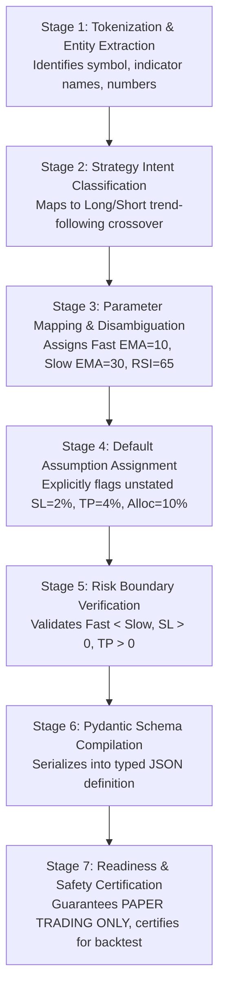

# QuantLens-XAI: Multi-Stage Decision Tracing & AI Risk Advisory System

**Course:** Explainable Artificial Intelligence (BCSE418L)  
**Academic Year:** 2026–27  
**Student:** Nikhil Anand  
**Reference:** Research Proposal Slides 3 & 4

---

## 1. Motivation & Problem Statement

In automated algorithmic trading, systems often fail due to:
1. **Misinterpreted Instructions**: Natural language ambiguities can lead an automated system to take catastrophic leverage or inverted positions.
2. **Hidden Assumptions**: Unspecified parameters (e.g. unstated stop-loss or allocation percentage) are frequently filled with silent defaults.
3. **Lack of Regime Context**: Strategies trained or configured for trending markets fail catastrophically during choppy, rangebound regimes.

QuantLens-XAI solves this by providing:
- A **7-Stage Progressive Decision Trace** revealing exactly how the prompt was tokenized, mapped, and bounded.
- An **AI Risk Advisory** providing educational regime caveats, false crossover warnings, and risk optimizations before any backtest or simulation is approved.

---

## 2. The 7-Stage Progressive Decision Trace

When a student or researcher enters an English strategy, the system generates seven sequential decision milestones:

### Trace Step Details

1. **Stage 1 (Tokenization & Entity Extraction)**:
   - Scans text for asset identifiers (e.g., `RELIANCE`), indicator keywords (`EMA`, `RSI`), and relational operators (`crosses above`, `below`).
2. **Stage 2 (Intent Classification)**:
   - Classifies trading intent as a directional momentum-trend strategy.
3. **Stage 3 (Parameter Mapping)**:
   - Sets fast period $10$, slow period $30$, RSI calculation period $14$, upper boundary $65.0$.
4. **Stage 4 (Default Assignment)**:
   - Any unspecified parameter is logged as an `AssumedDefault` and visually surfaced in the UI with a clickable override chip.
5. **Stage 5 (Risk Boundary Check)**:
   - Validates that risk rules satisfy mathematical sanity (SL $2.0\%$, TP $4.0\%$).
6. **Stage 6 (Schema Compilation)**:
   - Converts the mapped entities into the typed `StrategyDefinition` JSON structure.
7. **Stage 7 (Readiness Certification)**:
   - Confirms that execution is bound exclusively to the virtual paper broker.

---

## 3. Educational AI Advisory & Risk Warnings

The advisory panel outputs three core dimensions of financial decision support:

1. **Market Regime Warning**:
   > *"Dual EMA crossover systems suffer high whipsaw rates in sideways/choppy markets. When prices oscillate around the mean without a clear trend, consecutive false crossovers may trigger stop-losses."*

2. **False Crossover Risk**:
   > *"Moving averages inherently lag price action. In sharp 'V-shaped' reversals, the EMA(10)/EMA(30) exit signal may trigger after a substantial portion of the move has already retraced."*

3. **Risk Optimization Recommendations**:
   > *"Consider replacing fixed percentage stops with dynamic ATR trailing stops to adapt to changing volatility regimes, and require breakout volume to exceed the 20-day Volume SMA by at least 1.2x."*
