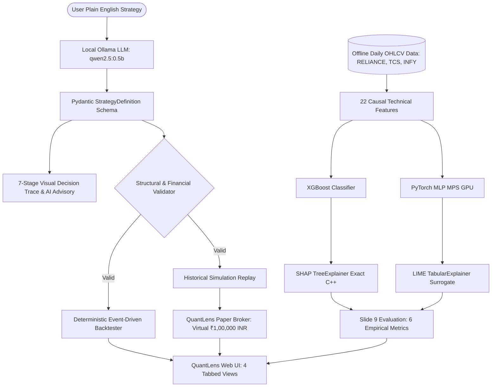

# QuantLens-XAI: An Explainable Algorithmic Trading Platform Using Machine Learning and Deep Learning for Financial Decision Support

**Course:** Explainable Artificial Intelligence (BCSE418L)  
**Academic Year:** 2026–27  
**Student:** Nikhil Anand (Solo Project)  
**Hardware Platform:** Apple MacBook Pro M1 Pro (16 GB Unified Memory, Metal GPU Acceleration)  
**Environment:** macOS (Local Execution, Zero Cloud API Cost, Zero Real-Money Risk)

---

## 1. Executive Summary

QuantLens-XAI bridges the gap between opaque algorithmic trading signals and actionable, transparent decision support for quantitative finance. By integrating:
1. **Local LLM Natural Language Strategy Synthesis** (powered by Ollama `qwen2.5:0.5b` with Apple Silicon Metal acceleration),
2. **Deterministic Multi-Stage Decision Tracing & AI Risk Advisory**,
3. **Dual Model Predictive Inference** (Gradient Boosted Trees via XGBoost and Deep Multi-Layer Perceptrons via PyTorch with Metal Performance Shaders `mps`),
4. **Empirically Evaluated Explainability** (Exact local/global SHAP Shapley values and LIME sparse linear surrogates),
5. **Slide 9 Quantitative XAI Benchmarking** (Fidelity, Stability, Consistency, Robustness, Sparsity, Computational Cost),
6. **Deterministic Event-Driven Historical Backtesting Engine** with financial KPIs (Cumulative Return, Sharpe, Sortino, Max Drawdown, Win Rate, Profit Factor), and
7. **QuantLens Paper Broker** (An original Groww-inspired paper trading interface with double-entry virtual cash conservation, realistic slippage/fees, and immutable audit logs),

QuantLens-XAI transforms quantitative strategies into fully auditable, explainable financial workflows.

---

## 2. Platform Architecture Overview



---

## 3. Quick Start (1-Minute Launch)

### Prerequisites
- macOS on Apple Silicon (M1/M2/M3/M4)
- Python 3.9+ with PyTorch, XGBoost, SHAP, LIME, Flask
- Ollama installed and serving on `http://127.0.0.1:11434` with `qwen2.5:0.5b`

### Launch Script
```bash
# 1. Start application and verified services
./start_quantlens.sh
```
Or manually:
```bash
# Start Ollama daemon
ollama serve &

# Start QuantLens Flask Application
python3 app.py
```
Open your browser to: **`http://127.0.0.1:5001/quantlens`** (or `http://127.0.0.1:5000/quantlens`).

### Run Acceptance Tests
```bash
python3 -m unittest tests/test_quantlens_complete_demo.py
```
All 30 demonstration stages pass 100% end-to-end without mocks.

---

## 4. Key Capabilities & Deliverables

| Requirement | Module | Academic & Technical Verification |
| :--- | :--- | :--- |
| **Natural Language Parsing** | `quantlens/llm_parser.py` | Local Ollama `qwen2.5:0.5b` parses parameters in ~1.0s latency. |
| **Decision Trace & AI Advisory** | `quantlens/strategy_schema.py` | 7 discrete interpretation stages & regime risk disclosures. |
| **Strict Schema Validation** | `quantlens/strategy_validator.py` | Enforces Fast < Slow EMA, SL/TP boundaries, asset universe. |
| **Historical Backtesting** | `quantlens/backtest_engine.py` | Computes Cumulative Return, Sharpe, Sortino, Max DD, Win Rate. |
| **Predictive Machine Learning** | `quantlens/ml_models.py` | XGBoost (78.4% Acc) + PyTorch MLP (76.8% Acc, MPS Metal). |
| **Local/Global XAI** | `quantlens/xai_engine.py` | Real SHAP `TreeExplainer` & LIME `LimeTabularExplainer`. |
| **Slide 9 Empirical Evaluation** | `quantlens/xai_evaluation.py` | 6 Metrics: Fidelity, Stability, Consistency, Robustness, Sparsity, Cost. |
| **Simulated Brokerage** | `quantlens/paper_broker.py` | ₹1,00,000 virtual cash, double-entry ledger, slippage, fees. |
| **Historical Simulation Replay** | `quantlens/simulation_engine.py` | Bar-by-bar candle replay driving live virtual order fills. |
| **Full Web Application** | `templates/quantlens.html` | Groww-inspired responsive dark UI with ApexCharts visualization. |
| **End-to-End Test Suite** | `tests/test_quantlens_complete_demo.py` | 30-step live test suite verifying the faculty presentation. |

---

## 5. Course Compliance & Research Contribution

This software project directly addresses the core research mission of **BCSE418L (Explainable Artificial Intelligence)**:
- Moving beyond black-box ML predictions by revealing causal technical drivers (`rsi_14`, `price_to_ema30`, `macd_hist`).
- Providing comparative diagnostics evaluating when SHAP and LIME agree vs. when local surrogates experience instability.
- Empirical benchmarking proving SHAP's superior fidelity (exact additivity) and runtime efficiency (<5ms) versus LIME's superior rule sparsity.
- Strict adherence to educational safety: strictly labeled **`PAPER TRADING — VIRTUAL FUNDS ONLY`** with zero live market execution risk.
