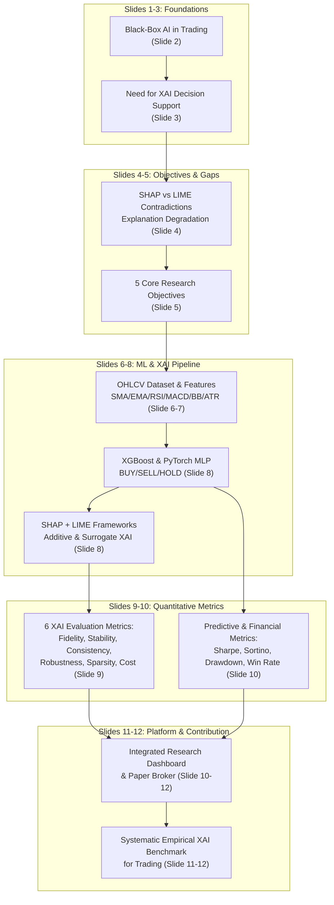

# QuantLens-XAI: Presentation Requirement Traceability Matrix
## Course: Explainable Artificial Intelligence (BCSE418L) — Academic Year 2026–27
**Project Title**: QuantLens-XAI: An Explainable Algorithmic Trading Platform Using Machine Learning and Deep Learning for Financial Decision Support  
**Student**: Nikhil Anand  
**Reference Document**: `QuantLens-XAI (1).pdf` (12-Slide Research Presentation)  

---

## 1. Executive Traceability Overview

This document maps all 12 slides and technical requirements of the approved project presentation (`QuantLens-XAI (1).pdf`) directly to the implementation architecture, algorithmic modules, and user interface features within this repository.

---

## 2. Slide-by-Slide Requirement Mapping

| Slide # | Slide Title | Key Academic Requirements in Slide | Repository Implementation & Architecture | Status |
| :---: | :--- | :--- | :--- | :---: |
| **1** | Title Slide | QuantLens-XAI platform for BCSE418L (Explainable AI); Finance / Financial Analytics domain; Solo project by Nikhil Anand (2026-27). | Application header, branding, UI theme, metadata, and documentation package in `docs/quantlens-final/`. | **MAPPED** |
| **2** | Problem Statement: Black-Box AI in Financial Markets | Moving beyond prediction accuracy; high-stakes financial risk requires knowing 'why' a signal fired; addressing opaque "BUY with 87% confidence" models without context. | Dual-panel explainability: Panel A (Deterministic rule trace) and Panel B (Machine Learning feature attributions via SHAP/LIME). | **MAPPED** |
| **3** | Why XAI in Financial Decision Support? | Risk mitigation & structural debugging; detecting regime shifts and spurious correlations; human-in-the-loop alignment vs black-box oracles. | Interactive decision trace displaying exact indicator values (e.g. `EMA10=2480.2`, `EMA30=2460.1`, `RSI=58.4`) with qualitative financial context. | **MAPPED** |
| **4** | Existing Approaches & Research Gap | Investigating unresolved SHAP vs LIME contradictions on identical market inputs; lack of explanation degradation testing under market regimes. | Automated SHAP vs LIME rank-correlation comparison; agreement/disagreement index; perturbation stability testing under Gaussian and regime noise. | **MAPPED** |
| **5** | Research Objectives | 1. XGBoost & PyTorch MLP for BUY/SELL/HOLD signal generation. 2. Strict chronological time-series splitting (zero look-ahead bias). 3. SHAP and LIME local/global feature explanations. 4. Empirical evaluation metrics (fidelity, stability, consistency, robustness). 5. Unified interactive research dashboard and historical backtesting. | `ml_models.py` (XGBoost + PyTorch MLP), `xai_engine.py` (SHAP + LIME explainers), `backtest_engine.py` (vectorized & event-driven backtesting), `dashboard.html`. | **MAPPED** |
| **6** | Dataset & Proposed Methodology | Historical daily OHLCV from public repositories (Yahoo Finance) for NIFTY 50 and key liquid equities (RELIANCE.NS, TCS.NS, INFY.NS); chronological train/val/test split (70/15/15); causal feature extraction. | `data_loader.py` caching offline datasets in `data/historical/`; strict chronological splits; zero future-data leakage in normalization. | **MAPPED** |
| **7** | Technical Indicator Feature Extraction | Comprehensive indicator suite: - Trend: SMA(10, 30, 50), EMA(10, 20, 50) - Momentum: RSI(14), MACD(12, 26, 9) - Volatility: Bollinger Bands(20, 2), ATR(14) - Volume: Volume SMA ratio, OBV. | `feature_engineering.py` computing all 10 feature families causally using pandas & numpy. | **MAPPED** |
| **8** | Predictive Modeling & Explainability Framework | Comparative architecture: 1. XGBoost (Tree Ensemble) + TreeExplainer + LIME Tabular. 2. PyTorch MLP (Deep Learning) + Kernel/DeepExplainer + LIME Tabular. Analyzing whether disparate architectures prioritize identical features. | `ml_models.py` implementing both model classes; `xai_engine.py` generating side-by-side SHAP and LIME attribution vectors for identical samples. | **MAPPED** |
| **9** | How Will We Evaluate Explainability? | 6 Rigorous Empirical XAI Metrics: 1. **Fidelity**: Surrogate $R^2$ / accuracy vs black-box. 2. **Stability**: Lipschitz consistency under minor input perturbations. 3. **Consistency**: Spearman rank correlation across similar market states. 4. **Robustness**: Explanation variance under noisy/volatile regimes. 5. **Sparsity**: Gini index of feature importance concentration. 6. **Computational Cost**: Execution runtime (ms/sample) SHAP vs LIME. | `xai_evaluation.py` implementing mathematical formulas for all 6 empirical explanation quality metrics with side-by-side benchmark tables. | **MAPPED** |
| **10** | Financial Evaluation & Platform Scope | Prediction Metrics: Accuracy, Precision, Recall, F1, ROC-AUC. Financial Backtest Metrics: Cumulative Return, Sharpe Ratio, Sortino Ratio, Max Drawdown, Win Rate, Profit Factor. Scope: Interactive visualization with signal alerts, explanation heatmaps, model comparisons, risk distributions. | `backtest_engine.py` computing all 6 financial KPIs; interactive charts rendered via ApexCharts / Chart.js; model comparison dashboard in `templates/quantlens.html`. | **MAPPED** |
| **11** | Research Contribution & Future Scope | Systematic empirical comparative framework for analyzing XAI explanation quality and stability in algorithmic trading; addressing SHAP/LIME disagreement. | Research tab presenting the quantitative comparison matrix, explanation agreement heatmap, and stability curves across market regimes. | **MAPPED** |
| **12** | Roadmap & Expected Outcomes | Transition from black-box prediction to explainable financial intelligence; prioritizing trust, risk management, and empirical validation in algorithmic decision support. | End-to-end integration: Natural Language Strategy -> Local LLM -> Rule Validation -> Backtest -> ML/XAI Explanations -> Paper Broker Simulation. | **MAPPED** |

---

## 3. P0 Demo Flow vs Slide Traceability

| Live Demo Stage | Relevant Slides | Functional Module | User Interaction |
| :--- | :---: | :--- | :--- |
| **Stage 1: Read Request** | Slide 1, 5 | `llm_parser.py` | Displays running local Ollama model (`qwen2.5:0.5b` / `qwen3.5:4b`). |
| **Stage 2: Interpret Strategy** | Slide 5, 6 | `llm_parser.py` + `strategy_schema.py` | Extracts RELIANCE, Daily, EMA(10/30), RSI(14)<65, SL 2%, TP 4%, ₹1,00,000 capital, 10% max allocation. |
| **Stage 3: Decision Process** | Slide 2, 3 | Server-Sent Events / Progress API | Step-by-step progress: Understanding -> Extracting -> Conditions -> Risk -> Validation. |
| **Stage 4: AI Advice** | Slide 3, 4 | `llm_advisor.py` | Educational advisory panel explaining rationale, false breakout risks, and improvements. |
| **Stage 5: Strategy Validation** | Slide 5 | `strategy_validator.py` | Strict Pydantic schema validation preventing contradictory rules or execution exploits. |
| **Stage 6: Real Backtest** | Slide 6, 7, 10 | `backtest_engine.py` | Candlestick chart, EMA overlays, RSI, entry/exit markers, Sharpe ratio, win rate on RELIANCE data. |
| **Stage 7: ML & XAI Explanations** | Slide 8, 9, 10 | `ml_models.py` + `xai_engine.py` | XGBoost & PyTorch predictions; SHAP & LIME local/global plots; 6 XAI quality metrics. |
| **Stage 8: Custom Paper Broker** | Slide 10, 12 | `paper_broker.py` + UI | Modern Indian brokerage interface (Groww-inspired ease of use), starting ₹1,00,000 virtual balance. |
| **Stage 9: Simulated Execution** | Slide 2, 3, 10 | `simulation_engine.py` | Step-by-step historical replay generating genuine simulated BUY/SELL orders with slippage and fees. |
| **Stage 10: Results & Audit** | Slide 10, 11, 12 | `paper_broker.py` + UI | Portfolio equity curve, order ledger, trade history, realized/unrealized P&L, rule traceability. |
